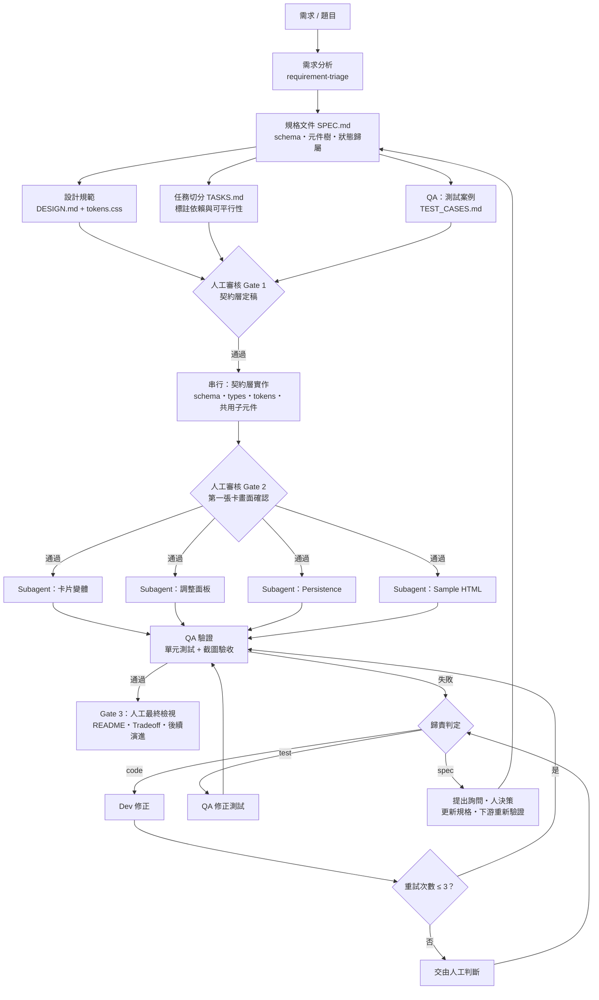

# 開發工作流程（Human-Agent Workflow）

> 專案：Merchant Card Showroom（Take-home 題目 B）
> 目的：說明本專案如何由人與 AI Agents 協作完成，以及每個階段的產出、責任與人工把關點。

---

## 1. 核心原則

1. **契約先行**：先定 schema、型別、design tokens，再寫實作。所有 agent 依同一份契約工作。
2. **先串行、後平行**：共用基礎（契約層）串行完成並經人工審核，之後才把彼此獨立的任務平行交給 subagents。
3. **出題與答題分離**：QA agent 依規格寫測試；Dev agent 實作時**不得修改測試檔**。
4. **兩層驗證**：邏輯用測試（TDD），畫面用截圖驗收加人工檢視。「測試通過」不等於「畫面正確」。
5. **迴圈有出口**：修正迴圈有次數上限，超過就交給人判斷；每個失敗都要歸責到「程式／測試／規格」其中一站。
6. **過程可追溯**：每個階段結束都 commit，AI 協作紀錄與人工判斷寫入 `docs/`。
7. **規格決策權在人**：任何 agent 遇到規格不明確、矛盾或缺漏，一律提出詢問，由人做決策。Agent 可以提供選項與建議，但不得自行假設後繼續（詳見第 5 節）。

---

## 2. 整體流程



---

## 3. 階段說明

### Phase 1：設計與規劃（約 1 小時，可與 AI 討論）

| 步驟 | 產出 | 負責 | 說明 |
|---|---|---|---|
| 1. 需求分析 | `docs/REQUIREMENTS.md` | AI + 人 | 拆解題目需求；所有不明確之處列為待決問題，交由人決策（見第 5 節） |
| 2. 卡片分析 | `docs/CARD_ANALYSIS.md` | AI + 人 | 觀察 momo 實際商品卡，歸納類型與欄位（排行卡、標準卡、搶購卡…） |
| 3. 規格文件 | `docs/SPEC.md` | AI 起草，人審 | **card schema**（欄位、型別、預設值、版本）、元件樹、狀態歸屬、對外 API（`<momo-card>`、`mount()`） |
| 4. 設計規範 | `docs/DESIGN.md` + `src/styles/tokens.css` | AI 起草，人審 | 文件說明規則，tokens 檔為唯一來源，禁止寫死顏色與尺寸 |
| 5. 任務切分 | `docs/TASKS.md` | AI 起草，人審 | 每個任務標註：輸入、輸出、依賴、可否平行、驗收條件 |
| 6. 測試案例 | `docs/TEST_CASES.md` | QA agent | 依規格寫出**行為導向**的測試案例，不綁 DOM 結構 |

**Gate 1（人工）**：確認 schema、tokens、任務依賴與測試案例，並清空 `docs/QUESTIONS.md` 中所有待決問題。這裡定稿的東西是後續所有 agent 的共同契約。

### Phase 2：實作（約 2 小時）

**Step A：串行，契約層**
- `schema/`：卡片定義與版本
- `core/`：純函式，負責驗證、套預設值、價格與折扣計算、銷量文字格式化
- `styles/tokens.css`
- 共用子元件：價格、評分、標籤、徽章
- 第一張卡：排行榜卡

**Gate 2（人工）**：實際看第一張卡的畫面，確認方向正確後才平行展開。避免多個 agent 在錯的基礎上同時開工。

**Step B：平行，subagents**

| Subagent | 任務 | 依賴 |
|---|---|---|
| Card | 第二種卡片變體，並驗證 registry 擴充機制 | 契約層 |
| Editor | 調整面板（依 schema 自動產生表單） | schema |
| Store | localStorage 存取、版本 key、migration、`storage` event 同步 | schema |
| Embed | `sample.html`（宣告式）與 `sample-mount.html`（命令式） | `<momo-card>` |

每個 subagent 只能改自己負責的目錄，測試檔一律唯讀。

**Step C：QA 驗證與修正迴圈**（見第 4 節）

**Gate 3（人工）**：最終檢視畫面、README、Tradeoff 說明與後續演進方向。

---

## 4. QA 驗證與修正迴圈

### 4.1 兩層驗證

| 層級 | 工具 | 驗什麼 | 不驗什麼 |
|---|---|---|---|
| 邏輯測試 | Vitest | schema 驗證、價格／折扣計算、欄位缺漏時的顯示規則、persistence 讀寫與 migration | 視覺細節 |
| 畫面驗收 | Playwright 截圖 + 人工檢視 | 排版、截斷、顏色、各變體實際長相、嵌入 sample 頁的效果 | 內部實作 |

### 4.2 測試撰寫規則

- ✅ 寫行為：「沒有原價時，不顯示劃線價」
- ❌ 不寫結構：「第 3 個 `span` 的 class 是 `price-origin`」

### 4.3 失敗歸責

每個失敗都要判定問題出在哪一站，再退回該站處理：

| 歸責 | 意義 | 處理 |
|---|---|---|
| `code` | 實作不符規格 | Dev agent 修正 |
| `test` | 測試對規格理解錯誤 | QA agent 修正測試，並記錄原因 |
| `spec` | 規格本身有漏洞或矛盾 | 提出詢問由人決策（第 5 節），再更新 SPEC.md，依賴它的下游全部重新驗證 |
| `env` | 環境或工具問題 | 人工處理 |

### 4.4 迴圈出口

- 同一個失敗最多重試 **3 次**，超過就交由人工判斷
- Dev agent **不得修改測試檔**；若認為測試有錯，只能提出歸責為 `test` 的申請，由人確認
- 每次人工介入都記錄在 `docs/AGENT_LOG.md`

---

## 5. 規格決策流程

### 5.1 規則

- 任何 agent 在任何階段遇到以下情況，都必須**停下並提出詢問**，不得自行假設後繼續：
  - 規格沒寫到（欄位、行為、邊界情況未定義）
  - 規格前後矛盾
  - 規格與實際觀察（momo 真實卡片）不一致
  - 有多種合理做法，且選擇會影響其他模組
- Agent 可以提供選項與建議，但**決策只由人做**。
- 不被該問題卡住的工作可以繼續；被卡住的任務標記為 `blocked`。
- 決策後必須同步更新 `docs/SPEC.md`，並依第 4.3 節讓受影響的下游重新驗證。

### 5.2 提問格式（寫入 `docs/QUESTIONS.md`）

```markdown
### Q-003：沒有原價時，折扣標籤要不要顯示？
- 提出者：QA agent ／ 階段：測試案例撰寫
- 背景：SPEC.md 只定義了 originalPrice 為選填，未說明折扣標籤的顯示條件
- 影響範圍：core/pricing、價格子元件、相關測試
- 選項：
  - A. 不顯示折扣標籤（建議：沒有原價就無法計算折扣）
  - B. 顯示活動給的固定折扣文字（如「滿1件享79折」）
- 狀態：待決 ／ blocked：T-04
```

### 5.3 決策紀錄（寫入 `docs/DECISIONS.md`）

```markdown
### D-003（回覆 Q-003）
- 決定：A，沒有原價時不顯示折扣標籤；活動文字改由 tagline 欄位呈現
- 理由：折扣必須可由資料計算，活動文案屬於另一種資訊
- 影響：SPEC.md 第 2.3 節已更新；T-04 解除 blocked
```

### 5.4 時間考量

- Phase 1 盡量把問題**一次批次提出**，在 Gate 1 一起決策，避免 Phase 2 頻繁中斷。
- Phase 2 出現的新問題照樣提問，但先處理沒被卡住的任務。

---

## 6. Agent 角色與權限

| 角色 | 職責 | 可寫入 | 唯讀 |
|---|---|---|---|
| Planner | 需求分析、起草規格、任務切分 | `docs/`（`DECISIONS.md` 除外） | — |
| Designer | 設計規範與 tokens | `docs/DESIGN.md`、`src/styles/` | `docs/SPEC.md` |
| QA | 測試案例、測試程式、驗收報告 | `tests/`、`docs/TEST_CASES.md` | `src/` |
| Dev（各 subagent） | 依任務實作 | 自己負責的 `src/` 子目錄 | `tests/`、`docs/SPEC.md` |
| Human（我） | **所有規格決策**、三個 Gate 的審核、歸責爭議的裁決、最終取捨 | 全部 | — |

所有 agent 都可以寫入 `docs/QUESTIONS.md` 提問；只有人可以寫入 `docs/DECISIONS.md`。

---

## 7. 人工把關點總覽

| Gate | 時機 | 確認重點 |
|---|---|---|
| Gate 1 | Phase 1 結束 | schema、tokens、任務依賴、測試案例是否合理 |
| Gate 2 | 第一張卡完成 | 畫面方向、子元件拆分是否可重用 |
| Gate 3 | 交付前 | 整體畫面、README、Tradeoff、後續演進 |
| 隨時 | 迴圈超過 3 次、歸責有爭議 | 判定是程式、測試還是規格的問題 |
| 隨時 | `QUESTIONS.md` 出現新問題 | 規格決策，寫入 `DECISIONS.md` |

---

## 8. Commit 與紀錄規範

- 每個階段或任務完成就 commit，訊息格式：`<type>(<scope>): <摘要>`，例如 `feat(card): add ranking card variant`
- AI 參與的 commit 加上 `Co-Authored-By` 紀錄
- `docs/AGENT_LOG.md` 記錄：
  - 每個 agent 的任務與產出
  - 人工介入的時間點、原因與決定
  - 被退回的錯誤與歸責結果

---

## 9. 刻意不做（範圍取捨）

- 視覺細節與 RWD 打磨
- SSR／SEO
- 真實 API 串接（以 mock data 與 `api/` 抽象層代替）
- 跨網域嵌入的設定同步（目前限同 origin 的 localStorage）
- 完整測試覆蓋（優先覆蓋 `core/` 純函式與 persistence）

以上項目會列在 README 的「後續演進方向」中。
